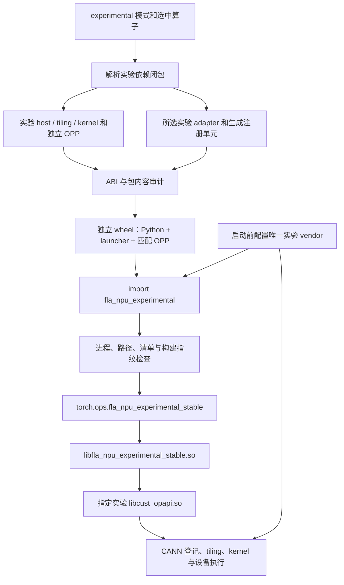
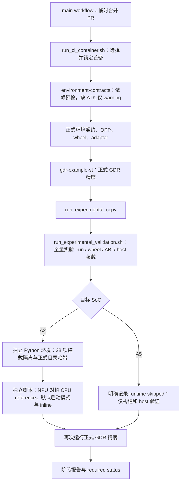

# FLA NPU experimental 独立构建与装载设计

作者：zzy1205。更新日期：2026-11-06。当前主干基线：`a13871e8`（初始实现基线 `fb3d47dd`）。

本文区分当前实现、目标兼容边界和验收要求；待补齐能力不计为已支持。组织方式参照
[OPP 增量叠加层设计](../OPP叠加层增量设计.md)。机器、命令、失败修正和结果见
[A2 验证记录](../../experimental/validation-a2-20261103.md)，用例定义见
[A2 功能与隔离验证方案](../../experimental/_tests/a2_isolation/README.md)。
机制实现、编译通过、加载通过和数值通过分别记录，不互相替代。
最近一次主干同步、最小改动范围及回归结果见 [2026-11-04 同步记录](../../experimental/validation-main-20261104.md)。
移除样例后的验证单列于 [2026-11-06 RWKV8 回归](../../experimental/validation-rwkv-only-20261106.md)。

## 1. 目的与范围

experimental 用于交付尚未进入正式算子集合的新接口与实现。选择实验模式后，发现、依赖解析、
host/kernel 编译、adapter 注册、打包和运行全部使用实验集合，不隐式借用正式算法源码或正式 OPP。

当前仅接入 [PR #446](https://github.com/flashserve/flash-linear-attention-npu/pull/446) 的
`fused_recurrent_rwkv8`，由该真实算子验证构建、打包、独立调用及装载隔离。
多算子发现、依赖与注册规则由临时测试夹具验证，不为框架验证额外维护一套计算算子。

| 功能 | 必要行为 |
| --- | --- |
| 实验构建闭包 | 只发现一级实验算子；依赖、公共算法头及真实路径保持在实验边界内 |
| 独立制品 | vendor、run 包、Python distribution、dispatcher、launcher 均有实验身份 |
| ABI 与来源门禁 | 检查所选 adapter、真实 public header、导出配对、制品哈希和 launcher 指纹 |
| 运行隔离 | 文件可共存；正式和实验 Python 执行使用独立新进程；自有实验符号不显式回落正式库或 CANN |
| 正式回归 | experimental 默认关闭；共享框架修改后验证正式构建、overlay 及真实算子调用 |

Stable ABI 是调用技术，正式/实验是产品分类。实验算子使用 Stable ABI，不意味着进入正式注册集。
本设计不支持 experimental overlay，不提供进程内热更新，不将实验制品接入正式发布，
不将构建脚本或动态链接器视为安全沙箱。算子更新通过重新构建并安装匹配实验 wheel 完成。

## 2. 架构与来源顺序



| 层 | 对象与负责方 | 实验约束 |
| --- | --- | --- |
| L1 | launcher 的 `Runtime::symbol()` 查询 ACLNN | 不消费正式 host 库列表；生成的自有符号集合未命中即失败 |
| L2 | CANN 读取算子登记 | `ASCEND_CUSTOM_OPP_PATH` 只能指向当前实验 vendor |
| L3 | CANN 读取 kernel 变体索引 | 构建与包审计限定为所选实验闭包和目标 SoC |
| L4 | CANN 使用 tiling、proto、kernel 与旁车数据 | 随匹配 OPP 一起交付；实际语义由真机对拍验证 |

L1 与 L2–L4 是不同的查找链。ABI 一致不能证明 tiling/kernel 语义一致；环境变量也不能单独
证明执行来源，验证还要记录进程映射、注册表和真实输出。

```text
experimental/
├── _common/                         # 公共头清单；当前没有必需的实验公共头
├── _framework/build.py              # 注册生成、launcher 编译、wheel 组装
├── _python/fla_npu_experimental/     # loader、Stable wrapper、Python 契约
├── _tests/a2_isolation/              # 独立进程装载矩阵
└── fused_recurrent_rwkv8/
    ├── CMakeLists.txt
    ├── adapter/stable_fused_recurrent_rwkv8.cpp
    └── op_host/、op_kernel/、docs/、tests/

site-packages/fla_npu_experimental/
├── __init__.py、_loader.py、_stable.py、各算子 wrapper
├── _op_abi.py                       # 按文件复制的通用 ABI helper
├── _build.json                      # Python / launcher / 源码与算子快照
├── libfla_npu_experimental_stable.so
└── opp/vendors/
    ├── config.ini
    └── fla_npu_experimental_transformer/
        ├── abi_manifest.json
        ├── experimental-build-manifest.json
        ├── bin/set_env.bash
        ├── op_api/{include,lib}/
        ├── op_impl/
        └── op_proto/
```

实验 wheel 不安装自动启动 `.pth`，不导入 `fla_npu`，不注册 `fla_npu_stable`。
distribution 按 SoC 分档，例如 `flash-linear-attention-npu-experimental-a2`。

## 3. 构建身份与闭包

| 项目 | 正式模式 | 实验模式 |
| --- | --- | --- |
| 入口 | 原 main 发现规则 | `build.sh --experimental` |
| 算子目录 | 原正式树 | `experimental/<op>/` 一级扁平目录 |
| vendor | `fla_npu_transformer` | `fla_npu_experimental_transformer` |
| run 包 | `fla_npu_linux-<arch>.run` | `fla_npu_experimental_linux-<arch>.run` |
| Python import | `fla_npu` | `fla_npu_experimental` |
| dispatcher | `fla_npu_stable` | `fla_npu_experimental_stable` |
| launcher | `libfla_npu_stable.so` | `libfla_npu_experimental_stable.so` |

### 3.1 build.sh 参数兼容边界

目标约定：在主干已有、可用的构建命令及参数组合上增加 `--experimental`，切换算子来源、
依赖闭包和制品身份，其余构建参数保持对应语义；experimental overlay 不支持。
准确开关名为 `--experimental`，不是 `--experiment`。该开关本身不替代 `--pkg` 等构建动作。
不能把当前实现的额外限制当作长期设计边界，也不能把“解析器接受参数”当作该功能已适配通过。

以下选择规则以 custom OPP 构建 `bash build.sh --pkg --experimental ...` 为例：

| 参数 | 实验模式语义 | 当前实现与证据 |
| --- | --- | --- |
| `--ops=fused_recurrent_rwkv8` | 选择指定实验算子及其传递实验依赖 | 已实现；RWKV8 单算子 A2 构建、打包与装载已验证 |
| `--ops=op_a,op_b` | 一次选择多个实验算子，合并依赖闭包并去重；`op_a/op_b` 须为实际存在的名称 | 框架已支持多算子选择、依赖和注册；当前用临时夹具验证，不声明本轮真实多算子 NPU 验收 |
| 不传 `--ops` | 选择全部实验算子 | 已实现默认全选；CMake 默认选择为 `ALL` |
| `--ops=all` / `--ops=ALL` | 与不传 `--ops` 的全选集合相同 | 已实现；本轮 A2 显式 `--ops=all` 构建与包审计已验证 |
| `--experimental --list-ops` | 只列出实验算子，不列正式算子及 `_` 开头的框架目录 | 已实现此顺序；反序 `--list-ops --experimental` 会提前列出正式集合，属于待修复缺陷 |
| 正式算子名或不存在的实验算子名 | 明确失败，不回落到正式集合或偷偷改为全编 | 已有名称及闭包校验 |

“全编”仅指实验集合及其依赖。当前真实实验集合只有 `fused_recurrent_rwkv8`，因此本轮
单算子和全编的集合相同，不能据此推断多个真实实验算子的联合构建或执行已验收。

其余参数的目标与当前差距如下；未逐项列出的主干有效构建参数也属于上述兼容目标。

| 参数或功能 | 目标边界 | 当前状态 |
| --- | --- | --- |
| `--soc`、`-j`、`-O`、`--build-type`、`--verbose`、`--bisheng_flags`、`--oom` 等编译选项 | 继续控制所选实验算子的目标、并行度和编译行为 | 复用主干解析与传递路径；不代表全部取值、组合及 SoC 都已实测 |
| `--kernel_template_input` 等带组合限制的参数 | 保留主干校验；例如模板输入只允许指定单个算子 | 不因实验模式放宽原有约束 |
| vendor 与 SoC 范围 | 保留主干现有约束，并使用独立实验身份 | 本轮基线固定正式 vendor 为 `fla_npu`、实验 vendor 为 `fla_npu_experimental`；custom 构建路径及实验 wheel 按单 SoC 使用，不承诺逗号分隔多 SoC 构建 |
| `--static` | 对主干有效的静态构建组合提供实验对应能力，保持源码和制品隔离 | 当前被实验构建模式检查明确拒绝，待适配；不是 overlay 之外的永久排除项 |
| `--jit` | 对主干有效的 JIT 组合提供实验对应能力，并匹配相应包审计规则 | 存在参数及 custom 构建分支；尚未完成实验制品端到端适配与验收，不能宣称完整支持 |
| `--ophost`、`--opapi`、`--opgraph`、`--opkernel` 等分目标构建 | 对主干有效组合只处理实验集合 | 尚未完成逐入口、逐产物的完整验证 |
| UT、`--example`、`--run_example` 及相关 PR 测试入口 | 从实验树选择测试及示例，使用实验制品，不借用正式算子入口 | `--example` 当前明确拒绝；其余入口尚未完整适配与验证 |
| 参数顺序及 `--PR_PKG` 等提前处理入口 | 等价参数顺序得到同一模式和算子集合 | `--list-ops`、`--PR_PKG` 等需补齐模式预解析及顺序回归 |
| overlay | 明确不支持 | 不增加实验 overlay 构建、安装、选择或运行回落能力 |

本节约束的是 `build.sh` 的构建参数兼容性，不扩大正式 wheel 打包入口、实验 `.run` 安装器
或运行时的支持范围。正式 wheel 仍拒绝实验参数；实验安装器仍要求独立空目录；wheel 内嵌
OPP 配套、固定实验身份、分进程装载等约束继续按第 4–6 节执行。

参数兼容验收必须分别记录名称发现、实际构建、包内容与适用的执行结果，并覆盖单选、多选、
默认全选、显式全选、传递依赖、参数顺序以及错误参数。共同支持的构建组合须对照正式模式
检查原有功能不回归；主干本身不支持的组合无需在实验模式新增。上述缺口补齐并验证前，
不得将当前版本描述为“除 overlay 外，build.sh 全部功能已等价支持”。

### 3.2 源码与依赖闭包

算子名匹配 `[A-Za-z0-9][A-Za-z0-9_.-]*`，`all/ALL` 保留；`_` 开头目录为框架目录。
根 `CMakeLists.txt` 标记算子，`<op>_depends` 声明依赖。`all` 展开为确定集合；
host 挂载、kernel 复制、adapter 注册和审计消费同一解析结果。

缺失依赖、循环、同名规范化冲突、越界软链、正式算法源/头引用均应明确失败。
实验公共算法代码使用 `_common` 的完整快照，不在缺文件时回落正式 common。
允许共享 CMake、SDK/OPBASE/Catlass、纯 ABI helper、Stable ABI 头和 tensor/stream 通用桥接。
共享代码修改须保留正式默认行为，并执行正式回归；这些检查不构成任意 CMake 程序的沙箱。

实验注册单元仅由所选 adapter 生成，不包含正式 `stable_ops.cpp`。指纹覆盖生成注册单元、
实验 adapter/Python、共享运行时和头；查询导出使用实验前缀。沿用 main 的 current stream、
队列投递和 tensor 生命周期处理，不复制一套旧 ctypes 描述符执行后端。

## 4. ABI 门禁、清单与完整性边界

| 阶段 | 检查与结果 |
| --- | --- |
| 选项预检 | 正式 wheel 入口拒绝实验参数；实验入口拒绝正式算子/身份；清理输出前失败 |
| 构建解析 | 记录所选集合、解析闭包、SoC、源码身份与文件哈希 |
| CPack staging | 复用 main ABI helper，检查 public header、真实导出和两阶段配对，生成 ABI 清单 |
| `.run` 构建完成 | 实验 adapter 与真实产物头做 ABI 比较，非空且覆盖完整 |
| `.run` 安装 | 检查目标、vendor、清单、ABI 哈希和链接边界，再在同级暂存目录组装并切换 |
| wheel 构建 | 审计实际 OPP 与来源清单、核验 adapter，执行 launcher 源码/ELF/符号门禁，封装匹配组件 |
| Python 配置 | 检查模式、唯一 vendor、包内路径、已载入模块/库和环境时序 |
| launcher 加载 | 验证 ABI 清单、Python/launcher 哈希、源码戳、算子快照和注册集合 |
| 后续调用 | 重查环境、正式/外部库及被监控文件的 inode/大小/mtime，拒绝切换或替换 |

`experimental-build-manifest.json` 负责来源、闭包和包审计信息；`abi_manifest.json` 负责 ACLNN
公共调用契约及 host/header 哈希；`_build.json` 绑定 wheel 的 Python、launcher 和算子快照。
三者职责互补，复用主线 ABI 解析器，不另造参数类型匹配规则。

运行期不执行 `nm`，也不逐次重哈希全部 kernel。清单不是数字签名；构建期包审计、
运行期 host/header 校验、调用期替换检测不能描述为任意文件篡改防护。
直接 `dlopen`/`torch.ops.load_library` 仍可载入共享库；实验入口再次检查时拒绝已知混用，
不承诺拦截底层加载器或恶意绕过公开入口的行为。

## 5. 安装、卸载与恢复

```bash
# 在独立 shell 初始化所选 CANN 和 Python 环境。
export FLA_NPU_DISABLE_PTH=1
bash build.sh --experimental --list-ops
bash build.sh --pkg --experimental --soc=ascend910b --ops=fused_recurrent_rwkv8 -j4
# 不传 --ops 或显式 --ops=all 均选择全部实验算子；同一 checkout 的构建串行执行。

# 目标必须是绝对空目录或尚不存在的目录，父目录必须存在。
bash build_out/fla_npu_experimental_linux-$(uname -m).run \
  --install-path=/absolute/experimental-opp --quiet
python scripts/experimental_manifest.py audit \
  --install-root /absolute/experimental-opp --soc ascend910b \
  --manifest build/experimental-build-manifest.json
python experimental/_framework/build.py wheel \
  --manifest build/experimental-build-manifest.json \
  --install-root /absolute/experimental-opp --output /absolute/experimental-wheels
# 将 matching-wheel.whl 替换为上一步生成的实际文件名。
python -m pip install --no-deps /absolute/experimental-wheels/matching-wheel.whl
```

实验 `.run` 不支持默认安装、`--install/--full/--cann`、overlay 或原位升级。
拒绝相对路径、路径中的软链、非空目标、活动 OPP/toolkit 以及已有正式包/OPP 子路径。
独立 wheel 必须使用自身内嵌、同次构建的 OPP，不能与外部 `.run` 任意拼装。

更新 Python/schema/adapter/ABI 或更换算子集时，重建完整匹配 wheel。
先停止使用该安装目录的进程，再由 pip 卸载/重装实验 distribution，最后启动新进程。
外部 `.run` 目录由调用方管理，回收前核实路径与使用者；不通过正式 overlay 管理器卸载实验包。

拒绝安装和复制失败应保持目标原状；不承诺断电、强杀或并发写入后的自动事务恢复。
`build`、`build_out` 会被构建入口清理，须先归档制品，禁止并发使用同一输出根。
失败或取消后确认本轮写入进程已停止再清理/重试，不复用旧成功标记充当新结果。

## 6. 启动、执行与 ATK 契约

| 输入 | 实验语义 |
| --- | --- |
| `FLA_NPU_DISABLE_PTH=1` | Python 启动前设置，阻止正式 wheel 启动钩子污染路径 |
| `FLA_NPU_EXPERIMENTAL_OPP_PATH` | 实验 OPP root；wheel 场景只能等于内嵌 root |
| `ASCEND_CUSTOM_OPP_PATH` | 只能包含当前实验 vendor，不能混入正式 base、overlay 或外部 vendor |
| `FLA_NPU_EXPERIMENTAL_OP_API_LIB` | loader 生成的实验 host 绝对路径，调用时拒绝被更改 |
| 正式 `FLA_NPU_OP_API_LIB(S)` / overlay 选择变量 | 不作为实验 host 来源，不为实验算子启用正式回落 |
| `FLA_NPU_STABLE_LAUNCH=inline` | 共享运行时的显式 inline 模式；默认按队列能力选择路径 |

```bash
export FLA_NPU_DISABLE_PTH=1
source /absolute/cann/set_env.sh
source /absolute/site-packages/fla_npu_experimental/opp/vendors/fla_npu_experimental_transformer/bin/set_env.bash
python - <<'PY'
import fla_npu_experimental                 # 必须先于 torch_npu / acl
import torch
import torch_npu
# 创建目标设备上的输入，再调用所选实验算子的公开 wrapper。
PY
```

toolkit 脚本准备 CANN 工具与依赖；vendor 脚本准备自定义 OPP 路径。source 不等于运行时初始化。
实验包须先于 `torch_npu`/`acl` 及相关 CANN 库加载进行配置。Python 启动后才关闭正式 `.pth`
不能撤销路径注入。同进程正式→实验、实验→正式，以及加载后切换路径或替换受监控文件均被拒绝。
切换模式须退出并启动新进程。

wrapper 通过独立 Stable dispatcher 检查输入设备一致性，并使用目标设备的当前 stream。
仅在队列能力可用时取 NoWait stream accessor；inline 使用安全 accessor。
RWKV8 保留三返回槽位、可选输出及零尺寸状态生命周期，并拒绝越界 `chunk_len`。

### 6.1 ATK worker 的准备（备选复验）

默认 CI 使用 `ci/run_experimental_accuracy.py` 直接进行 NPU / CPU reference 对拍，不依赖 ATK。
ATK 工程保留用于手工精度复验、确定性、MSS 和性能测试；下列 worker 准备只适用于该备选入口。

ATK 不选择 experimental vendor，也不替调用方安装 wheel。`run_test_cpu.sh` 激活 `ATK_ENV`，
source `CANN_ENV`，再 source `FLA_NPU_ENV`；实验任务必须指向实验 wheel 的 vendor 脚本。
executor 调用 `fla_npu_experimental`，CPU 标杆保持独立。

ATK 及 worker 可能先导入 `torch_npu`。本轮在专用、一次性 ATK 环境中安装
`00_experimental_atk_bootstrap.pth`，内容为 `import fla_npu_experimental`，并在任何 ATK/Python
进程启动前配置环境。此文件仅用于验证，不随 wheel 发布；维护测试 wheel 时先禁用 bootstrap，
装好匹配包并准备环境后再启用。装载顺序矩阵不得使用该 bootstrap。

远程或常驻 worker 须在自身启动环境完成同样准备，控制端后来 source 不会更新它们。
不要用源码 `PYTHONPATH` 冒充已安装 wheel；CANN 自身的 `acl/tbe` Python 路径仍须保留。

## 7. 检视入口与验收要求

| 检视组 | 主要文件 | 必查条件 |
| --- | --- | --- |
| 参数兼容 | `build.sh`、构建选项与相关契约测试 | 按第 3.1 节区分兼容目标、已实现机制、实际验证与待补齐项；覆盖选择规则及参数顺序 |
| 构建闭包 | `cmake/experimental.cmake`、`scripts/check_build_ops.py` | 名称、依赖、common、真实路径、空集合与负例 |
| ABI / 包 | `build.sh`、`scripts/experimental_manifest.py`、实验安装器 | 两阶段配对、adapter 覆盖、哈希、产物集合及错误安装 |
| launcher | `experimental/_framework/build.py`、通用编译器/Runtime | 独立注册、指纹、ELF 门禁、自有符号不回落、队列/stream 生命周期 |
| Python | `experimental/_python/fla_npu_experimental/` | 设备/参数契约、导入时序、配置冻结、包内来源及混用拒绝 |
| 装载隔离 | `experimental/_tests/a2_isolation/` | 28 项真实 wheel 矩阵、实际库/注册、保护目录哈希 |
| 数值/生命周期 | RWKV8 独立对拍脚本、备选 ATK、正式控制算子 | CPU 对拍、输出契约、实际库来源、两种 pip 顺序及安装/卸载回归 |
| 正式兼容 | 正式 OFF 构建与 overlay 测试 | 正式能力不受实验开关和制品生命周期影响 |

```bash
python -m unittest discover -s ci/tests -p 'test_experimental_*.py' -q
python -m unittest discover -s experimental/_python/tests -q
CI_SOC=ascend910b CI_EXPERIMENTAL_OPS=all bash ci/run_experimental_validation.sh
python experimental/_tests/a2_isolation/run.py --config /absolute/config.json --output /absolute/new-results
```

编译入口仅声明构建、打包和 host 加载。负例须匹配目标操作阶段的预期拒绝，超时、崩溃、
缺依赖、前置条件失败均不能记作隔离成功。目录哈希、模块路径、dispatcher、进程映射和数值分别留证。

历史 A2 已获得 RWKV8 209 条精度、全量 wheel/inline 冒烟及 28 项装载隔离证据，
安装与正式回归细节见验证记录。reverse、更完整的 stream、并发、确定性、MSS 和性能
矩阵仍须按范围补验。移除样例后的重新构建、装载隔离及定向数值结果见
[2026-11-06 回归记录](../../experimental/validation-rwkv-only-20261106.md)，包括卡 2 的基础
有限值检查异常和卡 1 的原 ATK 复验。A5 当前仅有历史编译/打包/加载证据。
不把集成验证写成全部算子、全部 SoC 或正式发布验收完成。

### 7.1 GitHub NPU CI 调度与失败边界

实验验证接入 `ci/run_checks.sh` 已有的 `gdr-example-st` 阶段，不新增 required status 或
独立 workflow。main 的 workflow 临时合并 PR 后执行该脚本，因此此调用链在 PR 合入前即生效；
PR push 自动执行契约单测，NPU CI 仍按仓库规则由授权人发起 quick/full。



- 完整 quick/full 流程执行实验全量构建；`CI_OPS` 仍只选择正式算子。`CI_STAGE` 截止在测试阶段
  之前的编译诊断不运行实验矩阵，也不能据此宣称实验验收通过。不增加默认关闭的实验开关。
- A2 quick：RWKV8 原精度 JSON 的前 3 条，默认启动模式和 inline 各 3 条；full：原 209 条各运行
  一遍。`ci/run_experimental_accuracy.py` 直接调用已安装的实验 wheel，NPU 输出与 CPU FP64
  递推后转 FP32 的标杆对拍。复用原 JSON、输入生成及 `mixed_tolerance_bm` v1 阈值，不降低
  精度标准。默认模式是否使用队列取决于 runtime 能力，不把两次精度
  通过表述为所有 stream/并发路径验收。
- 28 项装载矩阵使用全新环境，不继承父环境的正式/实验包或 `.pth`。直接对拍脚本先导入实验包再导入
  `torch_npu`；只有备选 ATK 的专用环境启用 bootstrap，装载顺序测试不启用。正式 overlay 只作正式路径的控制组，不表示实验支持 overlay。
- 当前实验集合只有 RWKV8，全量 wheel 同时用于单算子 profile。新增实验算子后须补选编制品和
  精度清单；CI 对未更新的覆盖配置直接失败，不能静默漏测新算子。
- A5 运行真实实验编译、安装、ABI、wheel、host 装载，A2 专用 runtime 阶段记录 `skipped` 及原因。
  host 装载或 A5 成功不等于实验 NPU 数值验证成功。
- 必要依赖缺失在 `environment-contracts` 阶段失败，后续构建不执行；构建、装载、精度或正式
  后置回归失败使 `gdr-example-st` 失败。独立对拍必须产生完整 JSON 报告，实际用例数和通过数
  必须等于本模式计划数；零用例、短跑、超时和崩溃不能记为成功。缺 ATK 只 warning，不跳过对拍。

`ci/check_experimental_environment.py` 在所有正式构建之前检查 `torch`、`torch_npu`、`numpy`、
`setuptools`、`wheel`、`pip`、`venv` 的真实导入；结果写入既有 stage 报告的
`experimental_dependencies`。实验总入口及仅构建入口也在编译前预检，因此手工调用同样提前报错。
正式 Example ST 原有的 Python 依赖检查也前置执行，原 adapter 阶段的复查保留。
ATK/Kombu 仅记录可用性并告警，默认路径不安装也不调用 ATK。备选 ATK 建议使用已验证的
26.9.8 + `kombu==5.6.2`（约束见 `ci/experimental-atk-constraints.txt`）。原
`CI_EXPERIMENTAL_ATK_WHEEL` 自动安装入口移除，备选环境由调用者提前准备。
quick/full 每种启动模式的进程超时分别为 660/7260 秒。实验验证不在全局 Python 环境安装或卸载 FLA 包。

独立对拍与 ATK executor 的输入生成、CPU reference 保持函数级 AST 一致性检查，避免两份拷贝漂移。
比较器与 ATK 的对齐测试仅在 `FLA_EXPERIMENTAL_TEST_ATK_PARITY=1` 时启用，不给默认 CI 引入 ATK 依赖。
输入只在 CPU 生成并量化一次，原 dtype 输入传到 NPU，同值 FP64 输入用于 CPU reference。
逐个验证 `o/s/sa` 的 shape、dtype、device、可选输出及有限值；`s/sa` 使用 FP32 阈值。
数值规则固定对齐 ATK 26.9.8 的 `mixed_tolerance_bm` v1（不是 `default`/v2）：

| 输出 dtype | rtol | atol | max_abs_error_limit |
| --- | --- | --- | --- |
| FP16 | 1.95e-3 | 1.95e-3 | 0.1 |
| BF16 | 1.56e-2 | 1.56e-2 | 1.0 |
| FP32 | 9.77e-4 | 1.53e-5 | 0.01 |

要求 `isclose` 元素比例 ≥ 0.99，且每个元素的绝对误差 ≤ max_abs_error_limit **或** ≤ 32 ULP；
ULP 以 golden 转为输出 dtype 后朝正无穷的间距计算。合法空输出在形状检查后通过。
原 PTA 的 FP32 累加 / relative-RMSE 冒烟脚本不作为此 CI 门禁。

`run_experimental_validation.sh` 保持仅构建/host 的独立用途，新增
`build_out/experimental-products.json` 供 CI 传递本次制品路径。总入口可手工复现：

```bash
# 先按正式 CI 步骤安装匹配本次源码的正式 OPP + adapter；无须安装 ATK。
FLA_NPU_DISABLE_PTH=1 CI_SOC=ascend910b CI_MODE=quick CI_CONTAINER_DEVICE=0 \
    python3 ci/run_experimental_ci.py
# 完整前置/后置正式回归和实验检查：
CI_SOC=ascend910b CI_MODE=quick bash ci/run_ci_container.sh
```

每次执行在 `CI_TMPDIR/experimental-ci-*`（未设置时为 `.ci-tmp/experimental-ci-*`）保留独立环境、
分阶段日志、隔离观察、逐用例对拍 JSON 和真实 NPU 调用后的库来源证据。分项状态、耗时、装载观察、
逐输出误差、阈值和失败日志尾部同步写入已有 `npu-ci-stages-<platform>.json` 的 `experimental`
字段，随 main 当前 workflow 的既有 artifact 上传，不依赖本 PR 修改 workflow 后才采集。
正式前后两轮 GDR 都必须成功；现有 accuracy report 保存后置正式回归结果。

## 8. 兼容与后续演进

实验接口转正时，须把源码、公开 wrapper、schema/adapter、测试和文档纳入正式集合并重建完整
正式 wheel，不能通过改 vendor 名称或安装 overlay 完成迁移。
experimental 保持单个匹配 OPP 的交付方式；不规划 overlay 支持。更新组件后重新构建匹配 wheel，
停止旧进程、完成安装并启动新进程。外部 OPP 拼装或同进程正式/实验共存不在当前支持范围内。
