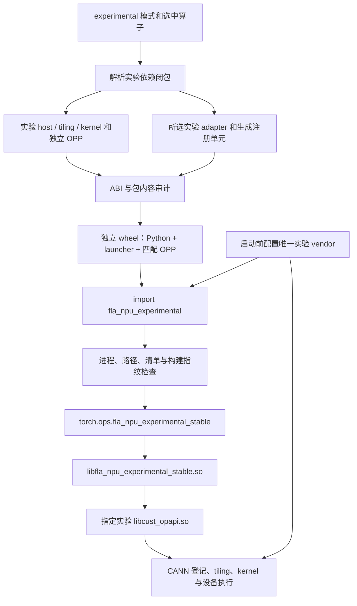
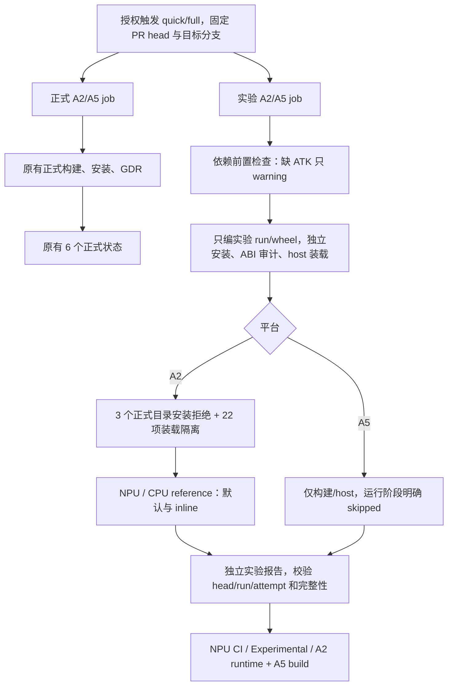

# FLA NPU experimental 独立构建与装载设计

作者：zzy1205。更新日期：2026-11-10。主干基线：`959d6b19`。

本文区分当前实现、目标兼容边界和验收要求；待补齐能力不计为已支持。
使用方法见 [experimental README](../../experimental/README.md)，实测证据集中在
[当前验证记录](../../experimental/validation.md)。机制实现、编译通过、装载通过和数值通过分别记录。

## 1. 目的与范围

experimental 用于交付尚未进入正式算子集合的新接口与实现。选择实验模式后，发现、依赖解析、
host/kernel 编译、adapter 注册、打包和运行全部使用实验集合，不隐式借用正式算法源码或正式 OPP。

当前仅接入 [PR #446](https://github.com/flashserve/flash-linear-attention-npu/pull/446) 的
`fused_recurrent_rwkv8`，由该真实算子验证构建、打包、独立调用及装载隔离。
多算子发现、依赖与注册规则由临时测试夹具验证，不为框架验证额外维护一套计算算子。

| 功能 | 必要行为 |
| --- | --- |
| 实验构建闭包 | 只发现一级实验算子；依赖、公共算法头及真实路径保持在实验边界内 |
| 独立制品 | vendor、run 包、Python distribution、dispatcher、launcher 均有实验身份 |
| ABI 与来源门禁 | 检查所选 adapter、真实 public header、导出配对、制品哈希和 launcher 指纹 |
| 运行隔离 | 独立环境与进程；自有实验符号不回落正式库或 CANN |
| 独立 CI | 正式和实验分别构建、验证、发布状态；实验不依赖正式制品 |

Stable ABI 是调用技术，正式/实验是产品分类。实验算子使用 Stable ABI，不意味着进入正式注册集。
本设计不支持 experimental overlay，不提供进程内热更新，不将实验制品接入正式发布，
不将构建脚本或动态链接器视为安全沙箱。算子更新通过重新构建并安装匹配实验 wheel 完成。

## 2. 架构与来源顺序



| 层 | 对象与负责方 | 实验约束 |
| --- | --- | --- |
| L1 | launcher 的 `Runtime::symbol()` 查询 ACLNN | 不消费正式 host 库列表；生成的自有符号集合未命中即失败 |
| L2 | CANN 读取算子登记 | `ASCEND_CUSTOM_OPP_PATH` 只能指向当前实验 vendor |
| L3 | CANN 读取 kernel 变体索引 | 构建与包审计限定为所选实验闭包和目标 SoC |
| L4 | CANN 使用 tiling、proto、kernel 与旁车数据 | 随匹配 OPP 一起交付；实际语义由真机对拍验证 |

L1 与 L2–L4 是不同的查找链。ABI 一致不能证明 tiling/kernel 语义一致；环境变量也不能单独
证明执行来源，验证还要记录进程映射、注册表和真实输出。

```text
experimental/
├── _common/                         # 公共头清单；当前没有必需的实验公共头
├── _framework/build.py              # 注册生成、launcher 编译、wheel 组装
├── _python/fla_npu_experimental/     # loader、Stable wrapper、Python 契约
├── _tests/isolation.py              # 单环境装载隔离与受保护目录检查
└── fused_recurrent_rwkv8/
    ├── CMakeLists.txt
    ├── adapter/stable_fused_recurrent_rwkv8.cpp
    └── op_host/、op_kernel/、docs/、tests/

site-packages/fla_npu_experimental/
├── __init__.py、_loader.py、_stable.py、各算子 wrapper
├── _op_abi.py                       # 按文件复制的通用 ABI helper
├── _build.json                      # Python / launcher / 源码与算子快照
├── libfla_npu_experimental_stable.so
└── opp/vendors/
    ├── config.ini
    └── fla_npu_experimental_transformer/
        ├── abi_manifest.json
        ├── experimental-build-manifest.json
        ├── bin/set_env.bash
        ├── op_api/{include,lib}/
        ├── op_impl/
        └── op_proto/
```

实验 wheel 不安装自动启动 `.pth`，不导入 `fla_npu`，不注册 `fla_npu_stable`。
distribution 按 SoC 分档，例如 `flash-linear-attention-npu-experimental-a2`。

## 3. 构建身份与闭包

| 项目 | 正式模式 | 实验模式 |
| --- | --- | --- |
| 入口 | 原 main 发现规则 | `build.sh --experimental` |
| 算子目录 | 原正式树 | `experimental/<op>/` 一级扁平目录 |
| vendor | `fla_npu_transformer` | `fla_npu_experimental_transformer` |
| run 包 | `fla_npu_linux-<arch>.run` | `fla_npu_experimental_linux-<arch>.run` |
| Python import | `fla_npu` | `fla_npu_experimental` |
| dispatcher | `fla_npu_stable` | `fla_npu_experimental_stable` |
| launcher | `libfla_npu_stable.so` | `libfla_npu_experimental_stable.so` |

### 3.1 build.sh 参数兼容边界

目标约定：在主干已有、可用的构建命令及参数组合上增加 `--experimental`，切换算子来源、
依赖闭包和制品身份，其余构建参数保持对应语义；experimental overlay 不支持。
准确开关名为 `--experimental`，不是 `--experiment`。该开关本身不替代 `--pkg` 等构建动作。
不能把当前实现的额外限制当作长期设计边界，也不能把“解析器接受参数”当作该功能已适配通过。

以下选择规则以 custom OPP 构建 `bash build.sh --pkg --experimental ...` 为例：

| 参数 | 实验模式语义 | 当前实现与证据 |
| --- | --- | --- |
| `--ops=fused_recurrent_rwkv8` | 选择指定实验算子及其传递实验依赖 | 已实现；RWKV8 单算子 A2 构建、打包与装载已验证 |
| `--ops=op_a,op_b` | 一次选择多个实验算子，合并依赖闭包并去重；`op_a/op_b` 须为实际存在的名称 | 框架已支持多算子选择、依赖和注册；当前用临时夹具验证，不声明本轮真实多算子 NPU 验收 |
| 不传 `--ops` | 选择全部实验算子 | 已实现默认全选；CMake 默认选择为 `ALL` |
| `--ops=all` / `--ops=ALL` | 与不传 `--ops` 的全选集合相同 | 已实现；本轮 A2 显式 `--ops=all` 构建与包审计已验证 |
| `--experimental --list-ops` | 只列出实验算子，不列正式算子及 `_` 开头的框架目录 | 已实现此顺序；反序 `--list-ops --experimental` 会提前列出正式集合，属于待修复缺陷 |
| 正式算子名或不存在的实验算子名 | 明确失败，不回落到正式集合或偷偷改为全编 | 已有名称及闭包校验 |

“全编”仅指实验集合及其依赖。当前真实实验集合只有 `fused_recurrent_rwkv8`，因此本轮
单算子和全编的集合相同，不能据此推断多个真实实验算子的联合构建或执行已验收。

其余参数的目标与当前差距如下；未逐项列出的主干有效构建参数也属于上述兼容目标。

| 参数或功能 | 目标边界 | 当前状态 |
| --- | --- | --- |
| `--soc`、`-j`、`-O`、`--build-type`、`--verbose`、`--bisheng_flags`、`--oom` 等编译选项 | 继续控制所选实验算子的目标、并行度和编译行为 | 复用主干解析与传递路径；不代表全部取值、组合及 SoC 都已实测 |
| `--kernel_template_input` 等带组合限制的参数 | 保留主干校验；例如模板输入只允许指定单个算子 | 不因实验模式放宽原有约束 |
| vendor 与 SoC 范围 | 保留主干现有约束，并使用独立实验身份 | 本轮基线固定正式 vendor 为 `fla_npu`、实验 vendor 为 `fla_npu_experimental`；custom 构建路径及实验 wheel 按单 SoC 使用，不承诺逗号分隔多 SoC 构建 |
| `--static` | 对主干有效的静态构建组合提供实验对应能力，保持源码和制品隔离 | 当前被实验构建模式检查明确拒绝，待适配；不是 overlay 之外的永久排除项 |
| `--jit` | 对主干有效的 JIT 组合提供实验对应能力，并匹配相应包审计规则 | 存在参数及 custom 构建分支；尚未完成实验制品端到端适配与验收，不能宣称完整支持 |
| `--ophost`、`--opapi`、`--opgraph`、`--opkernel` 等分目标构建 | 对主干有效组合只处理实验集合 | 尚未完成逐入口、逐产物的完整验证 |
| UT、`--example`、`--run_example` 及相关 PR 测试入口 | 从实验树选择测试及示例，使用实验制品，不借用正式算子入口 | `--example` 当前明确拒绝；其余入口尚未完整适配与验证 |
| 参数顺序及 `--PR_PKG` 等提前处理入口 | 等价参数顺序得到同一模式和算子集合 | `--list-ops`、`--PR_PKG` 等需补齐模式预解析及顺序回归 |
| overlay | 明确不支持 | 不增加实验 overlay 构建、安装、选择或运行回落能力 |

本节约束的是 `build.sh` 的构建参数兼容性，不扩大正式 wheel 打包入口、实验 `.run` 安装器
或运行时的支持范围。正式 wheel 仍拒绝实验参数；实验安装器仍要求独立空目录；wheel 内嵌
OPP 配套、固定实验身份、分进程装载等约束继续按第 4–6 节执行。

参数兼容验收必须分别记录名称发现、实际构建、包内容与适用的执行结果，并覆盖单选、多选、
默认全选、显式全选、传递依赖、参数顺序以及错误参数。共同支持的构建组合须对照正式模式
检查原有功能不回归；主干本身不支持的组合无需在实验模式新增。上述缺口补齐并验证前，
不得将当前版本描述为“除 overlay 外，build.sh 全部功能已等价支持”。

### 3.2 源码与依赖闭包

算子名匹配 `[A-Za-z0-9][A-Za-z0-9_.-]*`，`all/ALL` 保留；`_` 开头目录为框架目录。
根 `CMakeLists.txt` 标记算子，`<op>_depends` 声明依赖。`all` 展开为确定集合；
host 挂载、kernel 复制、adapter 注册和审计消费同一解析结果。

缺失依赖、循环、同名规范化冲突、越界软链、正式算法源/头引用均应明确失败。
实验公共算法代码使用 `_common` 的完整快照，不在缺文件时回落正式 common。
允许共享 CMake、SDK/OPBASE/Catlass、纯 ABI helper、Stable ABI 头和 tensor/stream 通用桥接。
共享代码修改须保留正式默认行为，并执行正式回归；这些检查不构成任意 CMake 程序的沙箱。

实验注册单元仅由所选 adapter 生成，不包含正式 `stable_ops.cpp`。指纹覆盖生成注册单元、
实验 adapter/Python、共享运行时和头；查询导出使用实验前缀。沿用 main 的 current stream、
队列投递和 tensor 生命周期处理，不复制一套旧 ctypes 描述符执行后端。

## 4. ABI 门禁、清单与完整性边界

| 阶段 | 检查与结果 |
| --- | --- |
| 选项预检 | 正式 wheel 入口拒绝实验参数；实验入口拒绝正式算子/身份；清理输出前失败 |
| 构建解析 | 记录所选集合、解析闭包、SoC、源码身份与文件哈希 |
| CPack staging | 复用 main ABI helper，检查 public header、真实导出和两阶段配对，生成 ABI 清单 |
| `.run` 构建完成 | 实验 adapter 与真实产物头做 ABI 比较，非空且覆盖完整 |
| `.run` 安装 | 检查目标、vendor、清单、ABI 哈希和链接边界，再在同级暂存目录组装并切换 |
| wheel 构建 | 审计实际 OPP 与来源清单、核验 adapter，执行 launcher 源码/ELF/符号门禁，封装匹配组件 |
| Python 配置 | 检查模式、唯一 vendor、包内路径、已载入模块/库和环境时序 |
| launcher 加载 | 验证 ABI 清单、Python/launcher 哈希、源码戳、算子快照和注册集合 |
| 后续调用 | 重查环境、正式/外部库及被监控文件的 inode/大小/mtime，拒绝切换或替换 |

`experimental-build-manifest.json` 负责来源、闭包和包审计信息；`abi_manifest.json` 负责 ACLNN
公共调用契约及 host/header 哈希；`_build.json` 绑定 wheel 的 Python、launcher 和算子快照。
三者职责互补，复用主线 ABI 解析器，不另造参数类型匹配规则。

运行期不执行 `nm`，也不逐次重哈希全部 kernel。清单不是数字签名；构建期包审计、
运行期 host/header 校验、调用期替换检测不能描述为任意文件篡改防护。
直接 `dlopen`/`torch.ops.load_library` 仍可载入共享库；实验入口再次检查时拒绝已知混用，
不承诺拦截底层加载器或恶意绕过公开入口的行为。

## 5. 安装、卸载与恢复

```bash
# 在独立 shell 初始化所选 CANN 和 Python 环境。
export FLA_NPU_DISABLE_PTH=1
bash build.sh --experimental --list-ops
bash build.sh --pkg --experimental --soc=ascend910b --ops=fused_recurrent_rwkv8 -j4
# 不传 --ops 或显式 --ops=all 均选择全部实验算子；同一 checkout 的构建串行执行。

# 目标必须是绝对空目录或尚不存在的目录，父目录必须存在。
bash build_out/fla_npu_experimental_linux-$(uname -m).run \
  --install-path=/absolute/experimental-opp --quiet
python scripts/experimental_manifest.py audit \
  --install-root /absolute/experimental-opp --soc ascend910b \
  --manifest build/experimental-build-manifest.json
python experimental/_framework/build.py wheel \
  --manifest build/experimental-build-manifest.json \
  --install-root /absolute/experimental-opp --output /absolute/experimental-wheels
# 将 matching-wheel.whl 替换为上一步生成的实际文件名。
python -m pip install --no-deps /absolute/experimental-wheels/matching-wheel.whl
```

实验 `.run` 不支持默认安装、`--install/--full/--cann`、overlay 或原位升级。
拒绝相对路径、路径中的软链、非空目标、活动 OPP/toolkit 以及已有正式包/OPP 子路径。
独立 wheel 必须使用自身内嵌、同次构建的 OPP，不能与外部 `.run` 任意拼装。

更新 Python/schema/adapter/ABI 或更换算子集时，重建完整匹配 wheel。
先停止使用该安装目录的进程，再由 pip 卸载/重装实验 distribution，最后启动新进程。
外部 `.run` 目录由调用方管理，回收前核实路径与使用者；不通过正式 overlay 管理器卸载实验包。

拒绝安装和复制失败应保持目标原状；不承诺断电、强杀或并发写入后的自动事务恢复。
`build`、`build_out` 会被构建入口清理，须先归档制品，禁止并发使用同一输出根。
失败或取消后确认本轮写入进程已停止再清理/重试，不复用旧成功标记充当新结果。

## 6. 启动、执行与 ATK 契约

| 输入 | 实验语义 |
| --- | --- |
| `FLA_NPU_DISABLE_PTH=1` | Python 启动前设置，阻止正式 wheel 启动钩子污染路径 |
| `FLA_NPU_EXPERIMENTAL_OPP_PATH` | 实验 OPP root；wheel 场景只能等于内嵌 root |
| `ASCEND_CUSTOM_OPP_PATH` | 只能包含当前实验 vendor，不能混入正式 base、overlay 或外部 vendor |
| `FLA_NPU_EXPERIMENTAL_OP_API_LIB` | loader 生成的实验 host 绝对路径，调用时拒绝被更改 |
| 正式 `FLA_NPU_OP_API_LIB(S)` / overlay 选择变量 | 不作为实验 host 来源，不为实验算子启用正式回落 |
| `FLA_NPU_STABLE_LAUNCH=inline` | 共享运行时的显式 inline 模式；默认按队列能力选择路径 |

```bash
export FLA_NPU_DISABLE_PTH=1
source /absolute/cann/set_env.sh
source /absolute/site-packages/fla_npu_experimental/opp/vendors/fla_npu_experimental_transformer/bin/set_env.bash
python - <<'PY'
import fla_npu_experimental                 # 必须先于 torch_npu / acl
import torch
import torch_npu
# 创建目标设备上的输入，再调用所选实验算子的公开 wrapper。
PY
```

toolkit 脚本准备 CANN 工具与依赖；vendor 脚本准备自定义 OPP 路径。source 不等于运行时初始化。
实验包须先于 `torch_npu`/`acl` 及相关 CANN 库加载进行配置。Python 启动后才关闭正式 `.pth`
不能撤销路径注入。同进程正式→实验、实验→正式，以及加载后切换路径或替换受监控文件均被拒绝。
切换模式须退出并启动新进程。

wrapper 通过独立 Stable dispatcher 检查输入设备一致性，并使用目标设备的当前 stream。
仅在队列能力可用时取 NoWait stream accessor；inline 使用安全 accessor。
RWKV8 保留三返回槽位、可选输出及零尺寸状态生命周期，并拒绝越界 `chunk_len`。

### 6.1 ATK worker 的准备（备选复验）

默认 CI 使用 `ci/run_experimental_accuracy.py` 直接进行 NPU / CPU reference 对拍，不依赖 ATK。
ATK 工程保留用于手工精度复验、确定性、MSS 和性能测试；下列 worker 准备只适用于该备选入口。

ATK 不选择 experimental vendor，也不替调用方安装 wheel。`run_test_cpu.sh` 激活 `ATK_ENV`，
source `CANN_ENV`，再 source `FLA_NPU_ENV`；实验任务必须指向实验 wheel 的 vendor 脚本。
executor 调用 `fla_npu_experimental`，CPU 标杆保持独立。

ATK 及 worker 可能先导入 `torch_npu`。使用备选 ATK 验证时，在专用、一次性环境中安装
`00_experimental_atk_bootstrap.pth`，内容为 `import fla_npu_experimental`，并在任何 ATK/Python
进程启动前配置环境。此文件仅用于备选验证，不随 wheel 发布；维护测试 wheel 时先禁用 bootstrap，
装好匹配包并准备环境后再启用。装载顺序矩阵不得使用该 bootstrap。

远程或常驻 worker 须在自身启动环境完成同样准备，控制端后来 source 不会更新它们。
不要用源码 `PYTHONPATH` 冒充已安装 wheel；CANN 自身的 `acl/tbe` Python 路径仍须保留。

## 7. 检视入口与独立 CI

| 要求 | 实现入口 | 验证 |
| --- | --- | --- |
| 构建集合独立 | `build.sh`、`cmake/experimental.cmake`、`scripts/check_build_ops.py` | 正式 OFF / 实验 ON 发现、依赖闭包、多选与拒绝跨树输入 |
| 制品与安装独立 | `scripts/experimental_manifest.py`、实验安装器、`experimental/_framework/build.py` | 包内算子/ABI 审计、wheel 文件布局、真实 `.run` 拒绝正式目录 |
| 运行隔离 | 实验 loader / launcher、`experimental/_tests/isolation.py` | 单环境装载、混杂路径/库/模块拒绝、错误制品与加载后变更拒绝 |
| 功能正确 | `ci/run_experimental_accuracy.py`、`experimental/_tests/rwkv8_reference.py` | NPU 与 CPU reference 对拍、输出契约和实际调用来源 |
| 独立门禁 | `ci/run_experimental_ci.py`、`ci.yml` 的实验 job 和独立状态发布器 | A2 完整验证、A5 构建/host；缺报告、身份不匹配、异常均失败 |

保留现有 runtime 的全量 Python/launcher 指纹校验，以及每次调用的环境、进程映射和文件元数据检查。
本次只精简 CI 兼容矩阵与重复入口，不改变运行时变更检测行为。
构建来源清单只记录 `CMakeLists.txt`、`op_host/`、`op_kernel/`、`adapter/` 和实验公共头；文档、测试、示例不再计入算子输入指纹。包内容、ABI 和实际编译产物的审计仍保留。

### 7.1 GitHub NPU CI 调度与失败边界



- 正式与实验 job 都只依赖 prepare。共用工作流内的执行步骤、镜像、设备锁和源码校验，但临时目录、容器名、构建缓存、artifact 和状态分开。各自的失败不会改写另一套状态。
- `run_checks.sh` 保持主干正式流程；`CI_SUITE=experimental` 由容器入口调用唯一的 `run_experimental_ci.py`。不再通过正式 GDR 夹带实验构建，也不再执行前后两遍正式 GDR。
- 完整 quick/full 请求同时运行两套门禁；带 `ops=` 的既有请求仍只是正式定向诊断，不运行实验，也不改写任何完整门禁。手工实验选编仍通过 `build.sh --experimental --ops=...`。
- 默认状态、触发去重和分支保护脚本包含实验独立 context。实验门禁检查同次运行的 A2/A5 报告、平台、SoC、模式、head SHA、run ID、attempt，且提交时 PR 仍打开、非草稿、head/base ref 未变化。
- Workflow 来自受保护目标分支，不会因为 PR 修改了 YAML 就自动执行新 job。合入前可在 A2 直接执行同一入口验证；合入后新调度生效，管理员按仓库规则更新必需状态检查。不得用旧 workflow 的成功冒充新实验 gate 已运行。

### 7.2 精简后的实验验证

`ci/check_experimental_environment.py` 在实验构建前检查 `torch`、`torch_npu`、`numpy`、`setuptools`、`wheel`、`pip`、`venv` 的真实导入。必要依赖缺失立即失败，ATK/Kombu 缺失只告警。ATK 是独立备选工程，不由默认 CI 安装。

只创建一个实验 Python 环境，继承 torch/CANN 依赖但不继承 FLA 包、用户 site 或 `.pth`。不准备正式 wheel、combined、overlay 或单算子别名 profile。用于负例的正式目录、模块和小型动态库是测试夹具，不作为正式算子可用性的证据。

- 实际 `.run` 安装至独立空目录并审计；另验证安装至正式包目录、其 `opp`、其新建子目录都被拒绝，原目录内容不变。wheel 采用独立 distribution/package，文件集合契约禁止正式入口。
- 22 项装载用例：实验独立加载，未关闭启动注入，正式/实验路径混杂，两种模块导入顺序，torch_npu 提前导入，异库提前/随后加载，路径或清单被替换，host/ABI/launcher/源码指纹/算子集合错误，外部 OPP、未注册算子、越界链接、Python 文件变化。每个用例使用新进程；副本上才执行破坏性负例。
- 负例必须在目标操作阶段命中预期异常；缺依赖、超时、崩溃、前置条件错误不能算成功。真实执行之后记录库映射和 dispatcher，确认只使用实验实现。
- A2 quick 默认/inline 各 3 条，full 各 209 条，沿用原 ATK JSON；输入先量化一次，NPU 使用原 dtype，同值 FP64 输入用于 CPU 递推，golden 转 FP32 比较。报告必须有准确的 case 索引、输出和通过数。
- CPU reference 由 CI、PTA、dump 复用。ATK 按工程规范保留自包含副本；契约测试检查造数 AST 和 FP32/FP64 逐输出一致。PTA 保留独有的边界/负例和原 FP32/relative-RMSE 诊断口径，不作为 CI 精度标准。

数值标准固定为 ATK 26.9.8 的 `mixed_tolerance_bm` v1：

| 输出 dtype | rtol | atol | max_abs_error_limit |
| --- | --- | --- | --- |
| FP16 | 1.95e-3 | 1.95e-3 | 0.1 |
| BF16 | 1.56e-2 | 1.56e-2 | 1.0 |
| FP32 | 9.77e-4 | 1.53e-5 | 0.01 |

要求 `isclose` 比例 ≥ 0.99，且每个元素的绝对误差 ≤ max_abs_error_limit 或 ≤ 32 ULP。ULP 以 golden 转为输出 dtype 后朝正无穷的间距计算。`o/s/sa` 分别检查 shape、dtype、device、可选输出和有限值，合法空输出在形状检查后通过。

`--build-only` 只验证编译/打包/host，不能替代 A2 gate；A5 自动使用此范围。输出目录包含 `summary.json`、阶段日志、隔离观察和逐用例误差。独立实验 artifact 上传 summary，里面保留失败日志尾部、数值细节和库来源证据。复现命令见 [experimental README](../../experimental/README.md#ci-与复现)。

reverse、更多 stream/并发、确定性、MSS、性能和 A5 数值仍不在此门禁覆盖范围；结果见[验证记录](../../experimental/validation.md)。

## 8. 兼容与后续演进

实验接口转正时，须把源码、公开 wrapper、schema/adapter、测试和文档纳入正式集合并重建完整
正式 wheel，不能通过改 vendor 名称或安装 overlay 完成迁移。
experimental 保持单个匹配 OPP 的交付方式；不规划 overlay 支持。更新组件后重新构建匹配 wheel，
停止旧进程、完成安装并启动新进程。外部 OPP 拼装或同进程正式/实验共存不在当前支持范围内。
