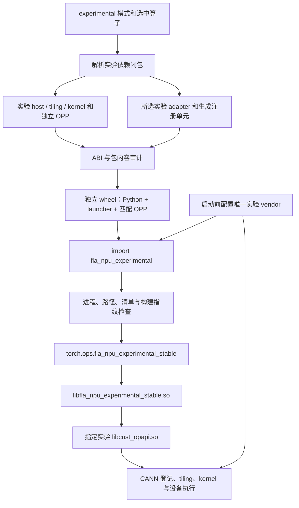
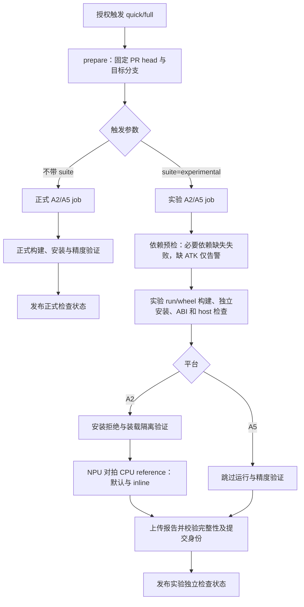

# FLA NPU experimental 独立构建与装载设计

作者：zzy1205。更新日期：2026-11-10。主干基线：`d51ab687`。

本文区分当前实现、目标兼容边界和验收要求；待补齐能力不计为已支持。
使用方法见 [experimental README](../../experimental/README.md)，实测证据集中在
[当前验证记录](../../experimental/validation.md)。机制实现、编译通过、装载通过和数值通过分别记录。

## 1. 目的与范围

experimental 用于交付尚未进入正式算子集合的新接口与实现。选择实验模式后，发现、依赖解析、
host/kernel 编译、adapter 注册、打包和运行全部使用实验集合，不隐式借用正式算法源码或正式 OPP。

当前仅接入 [PR #446](https://github.com/flashserve/flash-linear-attention-npu/pull/446) 的
`fused_recurrent_rwkv8`，由该真实算子验证构建、打包、独立调用及装载隔离。
多算子发现、依赖与注册规则由临时测试夹具验证，不为框架验证额外维护一套计算算子。

| 功能 | 必要行为 |
| --- | --- |
| 实验构建闭包 | 只发现一级实验算子；依赖、公共算法头及真实路径保持在实验边界内 |
| 独立制品 | vendor、run 包、Python distribution、dispatcher、launcher 均有实验身份 |
| ABI 与来源门禁 | 检查所选 adapter、真实 public header、导出配对、制品哈希和 launcher 指纹 |
| 运行隔离 | 独立环境与进程；自有实验符号不回落正式库或 CANN |
| 独立 CI | 正式和实验分别构建、验证、发布状态；实验不依赖正式制品 |

Stable ABI 是调用技术，正式/实验是产品分类。实验算子使用 Stable ABI，不意味着进入正式注册集。
本设计不支持 experimental overlay，不提供进程内热更新，不将实验制品接入正式发布，
不将构建脚本或动态链接器视为安全沙箱。算子更新通过重新构建并安装匹配实验 wheel 完成。

### 1.1 当前支持场景

以下按当前实现列出边界。“待适配/未验收”不等于已经支持，也不等于永久排除。
构建参数的长期兼容目标和逐项差距见 §3.1；平台与实测范围见验证记录。

| 维度 | 当前支持 | 明确不支持 | 待适配或未验收 |
| --- | --- | --- | --- |
| 构建 | 正式/实验分别选择源码和依赖闭包；实验 custom OPP、独立 run/wheel；`--ops` 单选、多选，不传或 `all/ALL` 全选实验集合 | 正式/实验混编；由正式 wheel 入口打包实验算子；experimental overlay | 当前只有 RWKV8 一个真实算子，多选只有夹具验证；`--static`、`--example` 当前拒绝；JIT、分目标、UT、示例及 PR 测试入口未完整适配，其他编译参数组合未穷举。`--list-ops` 当前要求 `--experimental` 在前 |
| 安装 | run 安装到显式独立空目录；拒绝写入正式包及其子路径；wheel 使用独立 distribution/package，在独立 Python 环境安装和卸载 | 默认装入 CANN、覆盖正式 wheel、run 原位升级、overlay | 不维护同一 Python 环境内正式/实验双包共存及安装顺序兼容矩阵；不承诺并发写入、断电或强杀后的事务恢复 |
| 运行 | A2 独立进程，独立实验 dispatcher/launcher/OPP；RWKV8 前向，FP16/BF16/FP32、可选初态及 `s/sa`；默认队列和 inline | 同进程正式/实验混用、加载后切换来源、外部 run 替换 wheel 内嵌 OPP、自有符号回落正式库、overlay/热更新、反向/autograd | reverse、多 stream/并发、确定性、MSS、性能和 A5 数值未验收；当前 RWKV8 未配置 A3；直接 aclnn 的非连续输出存在 §6.2 所述限制 |
| CI | 独立实验编排和检查状态；依赖预检前置，缺 ATK 只 warning；A2 构建/安装/隔离/NPU 对拍 CPU reference，A5 构建/host | 默认门禁不维护双包共存或 overlay 矩阵，不执行 A5 数值/性能/MSS/确定性；`ops=` 请求仅为正式定向诊断 | 新 GitHub job 须合入受保护 workflow 后调度并配置必需状态；当前精度门禁只覆盖 RWKV8，新增算子须补齐其验证 |

支持的运行配置是独立实验环境与新进程。distribution 名称不同、文件可以并列存放，不构成
同环境共存的兼容承诺。A2 当前完整入口已直接执行；A5 只有既往版本的构建/host 证据，
本轮未重跑 A5。新 GitHub job 的代码已接入，但尚未由受保护 workflow 调度。

## 2. 架构与来源顺序



| 层 | 对象与负责方 | 实验约束 |
| --- | --- | --- |
| L1 | launcher 的 `Runtime::symbol()` 查询 ACLNN | 不消费正式 host 库列表；生成的自有符号集合未命中即失败 |
| L2 | CANN 读取算子登记 | `ASCEND_CUSTOM_OPP_PATH` 只能指向当前实验 vendor |
| L3 | CANN 读取 kernel 变体索引 | 构建与包审计限定为所选实验闭包和目标 SoC |
| L4 | CANN 使用 tiling、proto、kernel 与旁车数据 | 随匹配 OPP 一起交付；实际语义由真机对拍验证 |

L1 与 L2–L4 是不同的查找链。ABI 一致不能证明 tiling/kernel 语义一致；环境变量也不能单独
证明执行来源，验证还要记录进程映射、注册表和真实输出。

```text
experimental/
├── _common/                         # 公共头清单；当前没有必需的实验公共头
├── _framework/build.py              # 注册生成、launcher 编译、wheel 组装
├── _python/fla_npu_experimental/     # loader、Stable wrapper、Python 契约
├── _tests/isolation.py              # 单环境装载隔离与受保护目录检查
└── fused_recurrent_rwkv8/
    ├── CMakeLists.txt
    ├── adapter/stable_fused_recurrent_rwkv8.cpp
    └── op_host/、op_kernel/、docs/、tests/

site-packages/fla_npu_experimental/
├── __init__.py、_loader.py、_stable.py、各算子 wrapper
├── _op_abi.py                       # 按文件复制的通用 ABI helper
├── _build.json                      # Python / launcher / 源码与算子快照
├── libfla_npu_experimental_stable.so
└── opp/vendors/
    ├── config.ini
    └── fla_npu_experimental_transformer/
        ├── abi_manifest.json
        ├── experimental-build-manifest.json
        ├── bin/set_env.bash
        ├── op_api/{include,lib}/
        ├── op_impl/
        └── op_proto/
```

实验 wheel 不安装自动启动 `.pth`，不导入 `fla_npu`，不注册 `fla_npu_stable`。
distribution 按 SoC 分档，例如 `flash-linear-attention-npu-experimental-a2`。

## 3. 构建身份与闭包

| 项目 | 正式模式 | 实验模式 |
| --- | --- | --- |
| 入口 | 原 main 发现规则 | `build.sh --experimental` |
| 算子目录 | 原正式树 | `experimental/<op>/` 一级扁平目录 |
| vendor | `fla_npu_transformer` | `fla_npu_experimental_transformer` |
| run 包 | `fla_npu_linux-<arch>.run` | `fla_npu_experimental_linux-<arch>.run` |
| Python import | `fla_npu` | `fla_npu_experimental` |
| dispatcher | `fla_npu_stable` | `fla_npu_experimental_stable` |
| launcher | `libfla_npu_stable.so` | `libfla_npu_experimental_stable.so` |

### 3.1 build.sh 参数兼容边界

目标约定：在主干已有、可用的构建命令及参数组合上增加 `--experimental`，切换算子来源、
依赖闭包和制品身份，其余参数保持对应语义；experimental overlay 不支持。
`--experimental` 是模式开关，需配合 `--pkg` 等动作。以下支持状态按当前交付范围填写。

以下选择规则以 custom OPP 构建 `bash build.sh --pkg --experimental ...` 为例：

| 参数 | 实验模式语义 | 是否实现 |
| --- | --- | --- |
| `--ops=fused_recurrent_rwkv8` | 选择指定实验算子及其依赖 | 已实现 |
| `--ops=op_a,op_b` | 选择多个实验算子，合并依赖并去重 | 已实现 |
| 不传 `--ops` | 全选实验算子 | 已实现 |
| `--ops=all` / `--ops=ALL` | 全选实验算子 | 已实现 |
| `--experimental --list-ops` | 列出实验算子 | 已实现 |
| `--list-ops --experimental` | 列出实验算子 | 未实现 |
| 正式算子名或不存在的实验算子名 | 拒绝构建 | 已实现 |

“全编”仅指实验集合及其依赖，当前真实实验算子只有 `fused_recurrent_rwkv8`。

其他参数的当前支持情况如下：

| 参数或功能 | 说明 | 是否支持 |
| --- | --- | --- |
| `--soc`、`-j`、`-O`、`--build-type`、`--verbose`、`--bisheng_flags`、`--oom` | 沿用主干参数语义及取值限制 | 支持 |
| `--kernel_template_input` | 沿用主干限制，仅允许指定单个算子 | 支持 |
| 固定实验 vendor、单 SoC | vendor 为 `fla_npu_experimental`，每次构建一个 SoC | 支持 |
| 自定义 vendor、多 SoC 同包 | 更改实验身份或一次构建多个 SoC | 不支持 |
| `--static` | 静态构建 | 不支持 |
| `--jit` | JIT 构建 | 不支持 |
| `--ophost`、`--opapi`、`--opgraph`、`--opkernel` | 分目标构建 | 不支持 |
| UT、`--example`、`--run_example` | 测试与示例入口 | 不支持 |
| 任意参数顺序、`--PR_PKG` 等提前处理入口 | 模式预解析与 PR 定向构建 | 不支持 |
| overlay | 实验增量叠加包 | 不支持 |

除 overlay 外，尚不支持的主干有效构建组合属于后续适配范围。安装和运行限制见第 5–6 节。

### 3.2 源码与依赖闭包

算子名匹配 `[A-Za-z0-9][A-Za-z0-9_.-]*`，`all/ALL` 保留；`_` 开头目录为框架目录。
根 `CMakeLists.txt` 标记算子，`<op>_depends` 声明依赖。`all` 展开为确定集合；
host 挂载、kernel 复制、adapter 注册和审计消费同一解析结果。

缺失依赖、循环、同名规范化冲突、越界软链、正式算法源/头引用均应明确失败。
实验公共算法代码使用 `_common` 的完整快照，不在缺文件时回落正式 common。
允许共享 CMake、SDK/OPBASE/Catlass、纯 ABI helper、Stable ABI 头和 tensor/stream 通用桥接。
共享代码修改须保留正式默认行为，并执行正式回归；这些检查不构成任意 CMake 程序的沙箱。

实验注册单元仅由所选 adapter 生成，不包含正式 `stable_ops.cpp`。指纹覆盖生成注册单元、
实验 adapter/Python、共享运行时和头；查询导出使用实验前缀。沿用 main 的 current stream、
队列投递和 tensor 生命周期处理，不复制一套旧 ctypes 描述符执行后端。

## 4. ABI 门禁、清单与完整性边界

ABI 门禁用于检查**本次构建的实验 launcher 与 OPP 是否配套**。launcher 通过动态符号调用
aclnn，编译器不能直接核对实际 host 库的函数原型；例如 host 新增一个 `bool` 参数而 adapter
仍使用旧参数列表，库可以加载，调用时却可能报错或错误解释参数。

这里复用主干检查，核对 adapter 的参数数量和逐位置类型、host 导出及 `GetWorkspaceSize`/
执行接口配对，并用清单绑定实际制品；校验时直接读取 ELF 动态符号表，确认清单覆盖真实导出。
实验接口可以修改，修改后重建匹配的 run/wheel；
不要求实验接口与正式算子相同，也不要求实验版本之间保持 ABI 不变。
包身份与路径检查负责正式/实验隔离，ABI 检查负责调用匹配，数值正确性由 NPU/CPU 对拍验证。

| 阶段 | 检查与结果 |
| --- | --- |
| 选项预检 | 正式 wheel 入口拒绝实验参数；实验入口拒绝正式算子/身份；清理输出前失败 |
| 构建解析 | 记录所选集合、解析闭包、SoC、源码身份与文件哈希 |
| CPack staging | 复用 main ABI helper，检查 public header、真实导出和两阶段配对，生成 ABI 清单 |
| `.run` 构建完成 | 实验 adapter 与真实产物头做 ABI 比较，非空且覆盖完整 |
| `.run` 安装 | 检查目标、vendor、清单、ABI 哈希和链接边界，再在同级暂存目录组装并切换 |
| wheel 构建 | 审计实际 OPP 与来源清单、核验 adapter，执行 launcher 源码/ELF/符号门禁，封装匹配组件 |
| Python 配置 | 检查模式、唯一 vendor、包内路径、已载入模块/库和环境时序 |
| launcher 加载 | 验证 ABI 清单、Python/launcher 哈希、源码戳、算子快照和注册集合 |
| 后续调用 | 重查环境、正式/外部库及被监控文件的 inode/大小/mtime，拒绝切换或替换 |

`experimental-build-manifest.json` 负责来源、闭包和包审计信息；`abi_manifest.json` 负责 ACLNN
公共调用契约及 host/header 哈希；`_build.json` 绑定 wheel 的 Python、launcher 和算子快照。
三者职责互补，复用主线 ABI 解析器，不另造参数类型匹配规则。
构建来源清单只记录算子 CMake、host、kernel、adapter 和实验公共头，排除文档、测试和示例。

运行期不执行 `nm`，也不逐次重哈希全部 kernel。清单不是数字签名；构建期包审计、
运行期 host/header 校验、调用期替换检测不能描述为任意文件篡改防护。
直接 `dlopen`/`torch.ops.load_library` 仍可载入共享库；实验入口再次检查时拒绝已知混用，
不承诺拦截底层加载器或恶意绕过公开入口的行为。

## 5. 安装、卸载与恢复

以下以 A2 为例，在仓库根目录执行；将环境名和 `/absolute/...` 替换为实际值。
Python 环境需预先安装匹配的 torch、torch_npu 和构建依赖。

### 5.1 构建与安装

```bash
# 关闭正式 wheel 的 Python 启动注入。
export FLA_NPU_DISABLE_PTH=1

# 激活用于构建和安装实验包的独立 Python 环境。
conda activate experimental-env

# 设置 CANN 编译工具和运行库路径。
source /absolute/ascend-toolkit/set_env.sh

# 列出当前可选的实验算子。
bash build.sh --experimental --list-ops

# 编译 A2 的 RWKV8 host/kernel，并生成独立实验 run 包。
bash build.sh --pkg --experimental --soc=ascend910b --ops=fused_recurrent_rwkv8 -j4

# 将实验 OPP 安装到指定独立空目录，父目录须已存在。
bash build_out/fla_npu_experimental_linux-$(uname -m).run \
  --install-path=/absolute/experimental-opp --quiet

# 核对已安装 OPP 的算子集合、目标 SoC、来源清单和 ABI。
python scripts/experimental_manifest.py audit \
  --install-root /absolute/experimental-opp --soc ascend910b \
  --manifest build/experimental-build-manifest.json

# 编译实验 launcher，并将 Python 包、launcher 和匹配 OPP 打成独立 wheel。
python experimental/_framework/build.py wheel \
  --manifest build/experimental-build-manifest.json \
  --install-root /absolute/experimental-opp --output /absolute/experimental-wheels

# 安装生成的实验 wheel，不改动环境中已准备好的依赖。
python -m pip install --no-deps /absolute/experimental-wheels/matching-wheel.whl
```

`matching-wheel.whl` 替换为实际文件名；不传 `--ops` 或指定 `--ops=all` 可全编实验算子。
同一 checkout 的构建串行执行，重建前归档需要保留的 `build_out` 制品。
run 拒绝相对路径、软链、非空目标、活动 OPP/toolkit 和正式包子路径，不支持默认安装或原位升级。
wheel 运行时只使用自身内嵌 OPP。

### 5.2 卸载、更新与恢复

先停止使用实验包的进程，在原实验 Python 环境中执行：

```bash
# 卸载 A2 实验 wheel 及其内嵌 OPP。
python -m pip uninstall flash-linear-attention-npu-experimental-a2

# 更新时安装新构建的完整匹配 wheel，随后按第 6 节启动新进程。
python -m pip install --no-deps /absolute/experimental-wheels/new-wheel.whl
```

恢复旧版本时，先卸载当前实验 wheel，再安装归档的旧 wheel：

```bash
# 恢复归档版本的 Python、launcher 和 OPP。
python -m pip install --no-deps /absolute/archived-wheels/previous-wheel.whl
```

外部 run 安装目录由调用方单独回收；pip 卸载不会删除该目录。
安装失败应保持目标原状；强杀或并发写入后，确认相关进程停止并检查目录后再清理重试。

## 6. 启动与执行

| 输入 | 实验语义 |
| --- | --- |
| `FLA_NPU_DISABLE_PTH=1` | Python 启动前设置，阻止正式 wheel 启动钩子污染路径 |
| `FLA_NPU_EXPERIMENTAL_OPP_PATH` | 实验 OPP root；wheel 场景只能等于内嵌 root |
| `ASCEND_CUSTOM_OPP_PATH` | 只能包含当前实验 vendor，不能混入正式 base、overlay 或外部 vendor |
| `FLA_NPU_EXPERIMENTAL_OP_API_LIB` | loader 生成的实验 host 绝对路径，调用时拒绝被更改 |
| 正式 `FLA_NPU_OP_API_LIB(S)` / overlay 选择变量 | 不作为实验 host 来源，不为实验算子启用正式回落 |
| `FLA_NPU_STABLE_LAUNCH=inline` | 共享运行时的显式 inline 模式；默认按队列能力选择路径 |

### 6.1 启动与调用步骤

在新 shell 中执行，将环境名及路径替换为第 5 节的实际安装位置。

```bash
# 在 Python 启动前关闭正式 wheel 的启动注入。
export FLA_NPU_DISABLE_PTH=1

# 激活已安装实验 wheel 的 Python 环境。
conda activate experimental-env

# 设置 CANN 运行库及工具路径。
source /absolute/ascend-toolkit/set_env.sh

# 选择实验 wheel 内嵌的 vendor，供 CANN 查找实验算子。
source /absolute/site-packages/fla_npu_experimental/opp/vendors/fla_npu_experimental_transformer/bin/set_env.bash

# 启动新 Python 进程并执行一次 RWKV8 前向调用。
python - <<'PY'
# 在 torch_npu/acl 初始化前配置实验 OPP 并检查装载隔离。
from fla_npu_experimental import fused_recurrent_rwkv8

# 导入张量框架和 NPU 后端。
import torch
import torch_npu

# 选择第 0 张可见 NPU 卡。
torch.npu.set_device(0)

# 创建六个 shape 为 (B,H,T,K)=(1,1,2,8) 的 FP32 零输入，此例 V=K。
q, w, k, v, z, b = (
    torch.zeros((1, 1, 2, 8), dtype=torch.float32, device="npu:0")
    for _ in range(6)
)

# 执行前向计算；默认不输出 s/sa，返回值为 (o, None, None)。
o, s, sa = fused_recurrent_rwkv8(q, w, k, v, z, b)

# 等待设备执行完成。
torch.npu.synchronize()

# 将输出读回 CPU 并显示结果，此例 o 应全部为零。
print(o.cpu(), s, sa)
PY
```

默认按运行时能力选择队列路径；需要强制 inline 时，在启动 Python 前设置
`FLA_NPU_STABLE_LAUNCH=inline`。两种方式都使用目标设备的当前 stream。
同进程混用正式/实验模块、加载后切换 OPP 或替换受监控文件会被拒绝，切换模式须重启进程。

### 6.2 RWKV8 直接 aclnn 的非连续输出限制

此项属于从 PR #446 迁入的 RWKV8 host 输出处理，独立于 experimental 的构建、安装和装载隔离。
需要区分两个入口：

| 调用入口 | 输出缓冲区由谁提供 | 当前影响 |
| --- | --- | --- |
| `fla_npu_experimental.fused_recurrent_rwkv8(...)` | Stable adapter 通过 `allocate_sizes` 新建连续输出；Python 签名没有 `out=` 参数 | 不触发此次非连续输出问题；已有 A2 精度门禁覆盖此路径 |
| `aclnnFusedRecurrentRwkv8GetWorkspaceSize(..., out, sOut, saOut, ...)` | 调用方提供 aclTensor，可携带非连续 strides | `out` 非连续时已复现 workspace 阶段失败；`sOut/saOut` 有同类代码，但尚未分别实测 |

当前 host 将输出先转连续，再作为写回目的地：

```cpp
auto out_ = l0op::Contiguous(out, executorPtr);
auto viewCopyResult = l0op::ViewCopy(outRet, out_, executorPtr);
```

对非连续输入，生成连续临时张量供 kernel 读取是正常做法；对调用方的输出，写回目的地必须
仍是原始缓冲区。这里 `Contiguous` 为非连续 `out` 生成 executor 管理的连续临时张量，
随后 `ViewCopy` 的目标变为临时张量，而没有向原 `out` 写回。

A2 / CANN 9.1.0 补测中，相同合法 shape 和 FP32 零输入，连续输出执行正确；改用最后一维
stride 为 2 的非连续输出 view，`GetWorkspaceSize` 返回 `561103`，错误为 `Output tensor should not from workspace`。
该次调用在准备阶段失败，未启动计算，不是已证实的静默数值错误。具体复现条件和对照结果见
[验证记录](../../experimental/validation.md#2026-11-10-直接-aclnn-输出布局补测)。

接口文档目前没有声明输出必须连续，故将其记录为直接 aclnn 的实现限制，不能把现有 Python
精度通过扩大解释为任意 aclTensor 输出布局都可用。最小修复方向是直接
`ViewCopy(outRet, out, executorPtr)`，`sOut/saOut` 同理，并补三个输出的非连续 view 对拍、
未选中存储区域保持不变及原连续/可选/空输出回归。此处只记录问题与修复方向，代码尚未修改；
无需因此调整 experimental loader、包身份或 CI 调度架构。

## 7. CI 调度流程



- `/run-npu-ci quick` 只运行正式 CI；`/run-npu-ci quick suite=experimental` 只运行实验 CI。`quick/full` 仍选择用例规模，不支持 `suite=all`。
- 正式和实验分别调度、分别发布状态；请求去重、并发组及结果复用按集合区分。共用镜像和设备锁，容器、临时目录、构建产物与报告分开。
- A2 验证 3 项安装拒绝、22 项装载隔离，并执行默认/inline 两种对拍；quick 各 3 条，full 各 209 条。A5 仅验证构建和 host 装载。
- 实验状态为 `NPU CI / Experimental / A2 runtime + A5 build`；构建、验证、报告或上传失败均不能通过，旧提交结果不能用于当前提交。
- `ops=` 请求只执行正式定向诊断，不能与 `suite=experimental` 混用；默认实验 CI 不依赖 ATK，备选工程使用方式见其 [README](../../tests/atk/fused_recurrent_rwkv8/README.md#atk-备选执行方式)。
- 评论解析器与目标分支 workflow 更新后命令才能生效；旧目标 workflow 不支持 `suite` 时明确报错，不回落正式 CI。新实验状态需加入分支保护；两套必需状态分别触发，互不代替。
- 合入前可按 [复现命令](../../experimental/README.md#ci-与复现) 直接运行，实测结果见 [验证记录](../../experimental/validation.md)。

## 8. 兼容与后续演进

实验接口转正时，须把源码、公开 wrapper、schema/adapter、测试和文档纳入正式集合并重建完整
正式 wheel，不能通过改 vendor 名称或安装 overlay 完成迁移。
experimental 保持单个匹配 OPP 的交付方式；不规划 overlay 支持。更新组件后重新构建匹配 wheel，
停止旧进程、完成安装并启动新进程。外部 OPP 拼装或同进程正式/实验共存不在当前支持范围内。
